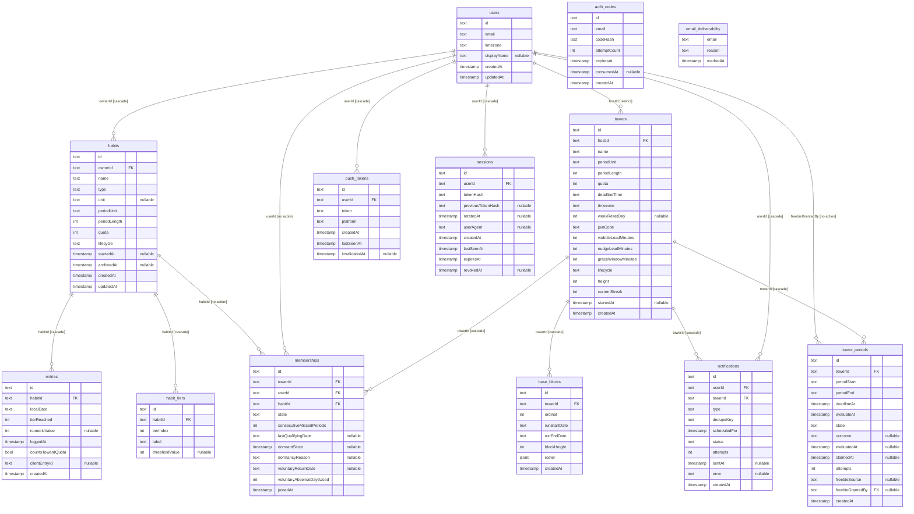

# Tower of Habit MonoRepo

## Development

### Setup

**Prerequisites:**

- Node 24.x (check `.nvmrc`)
- pnpm 9.x or later

**First-time setup:**

```bash
nvm use              # Uses .nvmrc
pnpm install         # Installs all workspaces
husky install        # Enables pre-commit hooks
pnpm migrate:dev       # Applies migrations to local dev database
pnpm migrate:seed     # Seeds local dev database
```

### Dev Scripts

pnpm dev # Runs dev in all workspaces in parallel
pnpm -F backend dev # Run backend only
pnpm -F client dev # Run client only
pnpm lint # Lint all workspaces
pnpm format # Format all files

### Services (Docker)

- `pnpm dev:up` / `dev:down` — start/stop Postgres, Redis, Caddy, api, and worker using `.env.dev`. This is the only variant that publishes Postgres (`127.0.0.1:5433` → container `5432`; override with `POSTGRES_HOST_PORT`) and Redis (`127.0.0.1:6379`) to the host, since `dev:api`/`dev:worker`/`migrate:dev` run on the host and need to reach the containers.
- `pnpm db:admin` — starts pgAdmin (and Postgres) at http://localhost:5050 (override with `PGADMIN_HOST_PORT`). Also started by `dev:up`. The `tower (dev)` server is pre-registered; enter `POSTGRES_PASSWORD` on first connect and tick "Save password".
- `pnpm services:up` / `services:down` — plain stack; no Postgres/Redis host ports.
- `pnpm services:up:staging` / `services:down:staging` — same as plain, using `.env.staging`.

### App processes (run on host, not containerized)

- `pnpm dev:api` — runs `apps/api` via `tsx watch`. Starts Postgres and Redis with host ports published first, so it needs no separate `dev:up`.
- `pnpm dev:worker` — same, for `apps/worker`.
- `pnpm dev:mobile` — starts the Expo app in `apps/mobile`.

### Database

- `pnpm db:generate` — runs `drizzle-kit generate` against `packages/db`; creates a new SQL migration file under `packages/db/migrations` from changes to `packages/db/src/schema.ts`. Run this first whenever the schema changes.
- `pnpm migrate:dev` — runs `drizzle-kit migrate` against `packages/db` using `.env.dev`; applies pending migrations. Requires `dev:up` for host access to Postgres.
- `pnpm migrate:test` — same, against the `tower_test` database using `.env.test`.
- Host-run tools connect through the published port, so the `DATABASE_URL` in `.env.dev` / `.env.test` must use `localhost:5433` (not `postgres:5432`, which only resolves inside Docker, and not `5432`, which a native Postgres install may already hold).
- `pnpm db:erd` — regenerates the schema ERD in both `docs/schema-erd.html` and the [ERD](#erd) section below from the Drizzle schema. Run after schema changes.
- `pnpm --filter @tower-of-habit/db studio` — opens Drizzle Studio against the local database.

### Quality checks

- `pnpm build`, `pnpm test`, `pnpm typecheck`, `pnpm lint`.
- `pnpm test:integration` — runs the API's integration suite (`apps/api/src/**/*.integration.test.ts`) against the real Postgres from Compose using `.env.test`: `pnpm dev:up`, `pnpm migrate:test`, then this. Tables are truncated before every test. `X-Test-Now` is honoured by the app under test, so a test can cross a period deadline without sleeping.
- `pnpm test:coverage` — runs each package's tests with V8 coverage. Per-package reports land in `packages/*/coverage/` and `apps/api/coverage/` (open `index.html`; `lcov.info` for editor/CI tools). The db suite needs Postgres: `pnpm dev:up` then `pnpm migrate:test`.
- `pnpm coverage:readme` — runs coverage and rewrites the table in [Coverage](#coverage) below. Run it before committing when you want the README numbers refreshed. If Postgres isn't reachable, the db row is kept and marked stale.

### Coverage

Last generated with `pnpm coverage:readme`. Coverage counts code that ran during tests, not code whose behavior was asserted.

<!-- coverage:start -->

| Package | Statements | Branches | Functions | Lines | Tests              |
| ------- | ---------: | -------: | --------: | ----: | ------------------ |
| shared  |      99.2% |    97.9% |    100.0% | 99.2% | 1613 passed (1613) |
| db      |      93.3% |    92.9% |     92.3% | 93.3% | 541 passed (541)   |
| api     |      53.5% |    90.1% |     84.3% | 53.5% | 173 passed (173)   |

<!-- coverage:end -->

### Adding packages

- `pnpm -F <package-name> add <dependency>` — adds a dependency to a specific package within the monorepo.
- `pnpm -F <package-name> remove <dependency>` — removes a dependency from a specific package within the monorepo.
- `pnpm add -D <package-name>` — adds a dev dependency to the root of the monorepo.
- `pnpm add <package-name>` — adds a dependency to the root of the monorepo.

### ERD

<!-- erd:start -->



<!-- erd:end -->
